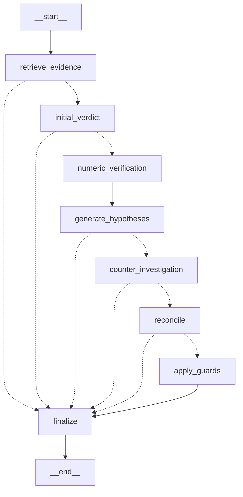

# LangGraph research architecture

## Layers

| Layer | Modules | Holds |
|---|---|---|
| Orchestration | `graphs/build.py`, `graphs/nodes.py`, `graphs/state.py` | Graph shape per approach, node entry/exit conditions, conditional routing, retry policy |
| Stages | `experiments/pipeline.py` | `ClaimRun` (ledger, retriever, conversation, budgets, usage), stage functions, guards, prediction/trace assembly |
| Tools (deterministic) | `engine/corpus.py`, `engine/numeric.py`, backend `evidence_ledger`, `xbrl_extract`, `sec_client` | Point-in-time SEC retrieval, XBRL arithmetic, citation validation |
| LLM access | `engine/llm.py`, `engine/prompts.py` | Response cache, offline/mock/live modes, paid-call approval, prompts + tool schemas |
| Experiment | `engine/config.py`, `engine/runner.py`, `scripts/run_experiment.py` | Frozen configs, fairness checks, immutable run directories |
| Evaluation (only place labels are read) | `engine/reference.py`, `engine/metrics.py`, `engine/stats.py`, notebooks 01, 04–06 | Reference labels, metrics, paired tests |

## Graph state

`ClaimState` (TypedDict) carries only serialisable data: claim fields from `ClaimInput`
(`claim_id`, `claim_text`, `company`, `evidence_cutoff`, `reporting_period`), `retrieved_evidence`,
`model_verdict`, `financial_verification`, `initial_verdict`, `contradiction_hypotheses`,
`counterevidence_queries`, `counterevidence`, `counter_numeric`, `contradiction_assessment`,
`reflection_weaknesses`, `second_look`, `final_verdict`, `verdict_changed`, `change_reason`, `reasoning`,
`evidence_ids`, `execution_trace` (append reducer), `token_usage`, `latency_ms`, `estimated_api_cost`,
`stop_reason`, `error`, `failed_stage`.

The per-run objects (evidence ledger, retriever, conversation, LLM client) travel in `GraphContext`
(LangGraph runtime context), not in the state.

The claim category is deliberately **not** in the state: "ambiguous" correlates with the
INSUFFICIENT_EVIDENCE reference label (28 of 50), so exposing it would give the model a prior.

## Graphs

Solid edges are fixed; dotted edges are conditional (a stage failure routes to `finalize`).

A3 — contradiction-aware (proposed):

SR — self-reflection control: same up to `numeric_verification`, then
`self_critique -.-> revise -.-> apply_guards --> finalize` (no retrieval, no numeric checks).

A2: `retrieve_evidence -> initial_verdict -> numeric_verification -> finalize`.
A1: `retrieve_evidence -> initial_verdict -> finalize`.
A3 with `contradiction.enabled = false` compiles to the A2 graph (ablation switch).

## Nodes

| Node | Entry condition | Exit condition | LLM | Retry |
|---|---|---|---|---|
| `retrieve_evidence` | claim fields | `retrieved_evidence` from filings filed ≤ cutoff | – | – |
| `initial_verdict` | `retrieved_evidence` | `model_verdict` with a valid label, or NO_VERDICT | 1 call | transient |
| `numeric_verification` | `model_verdict` | `financial_verification`, `initial_verdict` (after the deterministic rule) | – | – |
| `generate_hypotheses` | `financial_verification` | ≤ N falsification hypotheses, each with a query and optional figure | 1 call | transient |
| `counter_investigation` | hypotheses | new passages (already shown excluded) + computed figures per hypothesis; "nothing found" is recorded | – | – |
| `reconcile` | hypotheses + counter-evidence | per-hypothesis assessment + final verdict (`second_look`) | 1 call | transient |
| `self_critique` | `financial_verification` | ≤ N weaknesses | 1 call | transient |
| `revise` | weaknesses | revised verdict (`second_look`) | 1 call | transient |
| `apply_guards` | `second_look` | final label after guards: challenge needs valid evidence; a move to SUPPORTED / CONTRADICTED needs a valid citation; A2 rule re-applied | – | – |
| `finalize` | any | `prediction`, `trace` (incl. `trace.graph.execution_trace`), accounting fields | – | – |

Transient = timeouts, connection errors, HTTP 408/409/429/5xx/529; up to 3 attempts, identical request
(`ClaimRun.ask` extends the conversation only after a call returns). Paid-call refusals, budget stops and
cache misses are never retried.

## Outputs

`prediction` (one row in `predictions.jsonl`): label, initial label, validated citations, invalid citations,
unsupported-conclusion flag, token usage, latency, cost, LLM calls, retrieval queries, numeric checks, stop
reason, and for A3 / SR a `second_look_record`: `initial_verdict`, `initial_evidence`,
`contradiction_hypotheses`, `counterevidence_queries`, `counterevidence_found`, `no_counterevidence_found`,
`challenges_supported`, `guard_reverted`, `final_verdict`, `verdict_changed`, `change_reason`.
Whether a change was correct is computed at evaluation time (`metrics.second_look_metrics`), never in a node.

`trace` (one JSON per claim): config, prompt and engine versions, every LLM call with its output, every tool
call, the corpus (filings + sha256), every evidence unit, citations, and the graph execution trace.
